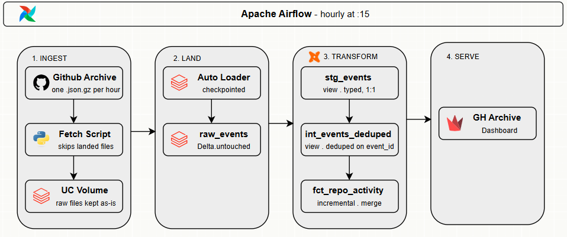

# GitHub Events Pipeline

An hourly, near-real-time pipeline that pulls public GitHub activity from [GH Archive](https://www.gharchive.org/), lands it in a Databricks Unity Catalog volume, streams it into a Delta table with **Auto Loader**, and models it with **dbt** into a repo-by-hour activity mart. **Airflow** orchestrates the whole flow and a **Streamlit** dashboard sits on top.

> **Status:** ran hourly from 23 September to 18 October 2026, then paused. The dataset and dashboard are static from that point. The dashboard's time window is anchored to the newest hour in the data rather than to the wall clock, so it still renders correctly.

## Results

| | |
|---|---|
| Events ingested | 9,100,125 |
| Raw rows landed | 9,100,210 |
| Date range | 23 Sept – 18 Oct 2026 |
| Duplicate events removed | 38 |
| Malformed payloads filtered | 47 |

Row counts reconcile end to end: `raw_events` → `stg_events` is exactly 1:1, and `sum(total_events)` in the mart equals `count(*)` in `int_events_deduped`. That second equality is the "aggregate after dedup, never before" decision verified rather than asserted — building the mart off `stg_events` would silently inflate every count.

## Architecture



## How it works

**Ingestion** — [ingestion/fetch_gharchive.py](ingestion/fetch_gharchive.py) downloads hourly `YYYY-MM-DD-H.json.gz` files and uploads them to the landing volume with the Databricks SDK. It runs 2 hours behind now (GH Archive publishes ~40 min after each hour, measured rather than guessed), skips files already landed, and treats a 404 as "not published yet" rather than an error. Backfill with `--date 2026-10-17 --hours 24`.

**Auto Loader** — [notebooks/land_raw_events.py](notebooks/land_raw_events.py) reads new files from the volume with `cloudFiles` as plain text, so each JSON event is stored untouched in `raw_event` and GitHub schema changes can't break ingestion. It adds `source_file`, `event_hour` (from the file name) and `ingested_at`.

Deriving `event_hour` from the filename rather than the clock is what makes backfills land chronologically. A file covering 17 October consumed on 18 October still carries `event_hour = 2026-10-17`.

**Checkpointing** — the stream writes with a checkpoint at `/Volumes/github_events/raw/checkpoints/raw_events`, which records which files have been ingested, so re-runs and retries never load a file twice. `trigger(availableNow=True)` processes whatever is new and stops, so a streaming source runs as an hourly batch with no always-on cluster.

**Databricks job** — the notebook runs as an unscheduled Databricks Job that Airflow triggers via `jobs.run_now(...).result()`, failing the task if the run isn't `SUCCESS`. Setup steps: [docs/databricks_job.md](docs/databricks_job.md).

**Orchestration** — [orchestrate.py](airflow_github_events/dags/orchestrate.py) runs `fetch → Auto Loader → dbt deps → source freshness → dbt build` at 15 past every hour, with `max_active_runs=1` and 2 retries per task. Every step is safe to retry: the fetch skips landed files, the checkpoint skips consumed files, and the mart merges rather than appends. Freshness is report-only — a stale source is a signal, not a reason to halt the build that would process the backlog. dbt lives in its own venv in the image because dbt-core and Airflow need conflicting `click` versions.

**dbt models** — `stg_events` parses the JSON, `int_events_deduped` keeps one row per `event_id`, and `fct_repo_activity` aggregates to one row per repo per hour with a 3-hour lookback for late files. Sources, tests and analyses: [github_events/README.md](github_events/README.md).

**Dashboard** — [dashboard/app.py](dashboard/app.py) shows full-run totals, activity KPIs, events per hour, top owners/repos, and a pipeline-health view. End-to-end latency while running was 2–3 hours: publish delay, plus up to an hour waiting for the next ingestion, plus up to an hour waiting for the next dbt run.

## Findings

### GitHub emits empty repo objects

A `not_null` test on `stg_events.repo_id` failed. Tracing it back to the preserved raw payload showed GitHub had emitted `"repo": {}` — an empty object, not malformed JSON — on a fork event whose `payload.forkee` was fully populated. The likely cause is the repo being deleted or made private between the event firing and the archive being written.

It occurred **47 times across 9.1 million events, and every single occurrence was a ForkEvent.** That is a consistent upstream behaviour rather than random corruption.

Handled as a `warn`-severity test in staging, so the count stays visible run to run without halting the pipeline, plus an explicit `where repo_id is not null` filter in `int_events_deduped`, commented with the reason. An event with no repo cannot be attributed in a repo-keyed fact table.

This is the clearest argument for keeping an untouched raw layer: the diagnosis was only possible because the original JSON was preserved exactly as it arrived.

### Decoupling ingestion from loading paid off

For several days the Databricks job trigger was unavailable while the fetch task kept succeeding. Files accumulated in the landing volume, unconsumed. Because the checkpoint tracks consumption rather than arrival, a single Auto Loader run afterwards caught up the entire backlog — no manual date ranges, no reprocessing of older files.

The mart needed a `--full-refresh` to pick those hours up, since the 3-hour lookback was sized for one or two missed runs rather than a multi-day gap.

### The dedup layer earns its place

Early in the run it removed zero rows: GH Archive assigns each event to exactly one hourly file, and both the fetch exists-check and the Auto Loader checkpoint prevent file-level reprocessing. After backfills that overlapped already-consumed hours, it removed 38 genuine duplicate event ids.

It exists because the `unique` test on `event_id` would otherwise be untestable, and because any change to the ingestion pattern introduces duplicates silently.

## Tradeoffs

**Incremental vs table for the mart.** The source grows hourly, so a full rebuild would re-scan all history to append one hour. Incremental keeps runtime flat. The cost is that the stored table can silently disagree with the model file — old rows were built by old SQL — so any change to an upstream model means a `--full-refresh` in the same commit, treated like a schema migration.

**Composite vs surrogate key.** `unique_key = ['repo_id', 'event_hour']` keeps the merge condition readable and the grain visible from the config alone. `generate_surrogate_key` earns its place above a certain key width — four or five parts, or wide string columns — and two integers is not it.

**Dedup in intermediate, not staging or marts.** Staging stays mechanical: rename and cast only. Dedup is business logic. Aggregating before dedup would produce a different and wrong answer, and nothing downstream would flag it.

**Three clocks, stated honestly.** GH Archive publishes on its own schedule, ingestion runs hourly, dbt runs hourly after that. The dashboard says 2–3 hours behind rather than claiming real-time.

## Known gaps

- **Two consecutive fetch failures** lose an hour permanently — the `--hours 2` overlap covers one missed run, not two. Recovery is a manual `--date` backfill. The freshness warning and the pipeline-health panel are what surface it.
- **No CI.** A GitHub Actions workflow building into a throwaway schema per PR was scoped out: single-contributor repo, and every change was already validated by the hourly run.
- **No alerting.** A failure callback to Slack plus a dead-man's switch would be the next addition. A failure callback only fires when a task runs and fails; it says nothing when Airflow itself is down.
- **Hourly partitioning** on `raw_events` follows the original spec but is a known Delta anti-pattern at scale — many small files. Partitioning by `event_date` with clustering on `event_hour`, or liquid clustering, would be the choice on a larger dataset.

## Quickstart

1. **Databricks:** create the catalog, schemas, volumes and the Auto Loader job — see [docs/databricks_job.md](docs/databricks_job.md).
2. **Configure** `airflow_github_events/.env` (never commit it):

   ```dotenv
   AIRFLOW_UID=50000
   DBT_HOST=<workspace>.cloud.databricks.com
   DBT_HTTP_PATH=/sql/1.0/warehouses/<warehouse-id>
   DBT_TOKEN=<personal-access-token>
   JOB_ID=<databricks-job-id>
   ```

3. **Start Airflow:**

   ```bash
   cd airflow_github_events
   docker compose up airflow-init
   docker compose up -d --build
   ```

   Open http://localhost:8080 (`airflow` / `airflow`) and unpause `github_events_hourly`.

4. **Dashboard** (with the same `DBT_*` variables exported):

   ```bash
   uv sync
   streamlit run dashboard/app.py
   ```

## Environment variables

| Variable | Purpose |
|---|---|
| `DBT_HOST` | Databricks workspace host |
| `DBT_TOKEN` | Databricks personal access token |
| `DBT_HTTP_PATH` | SQL warehouse HTTP path (dbt, dashboard) |
| `JOB_ID` | Auto Loader Databricks job ID (Airflow) |
| `LANDING_VOLUME_PATH` | Optional override for the landing volume |
| `SMTP_*` | Optional Airflow email settings |